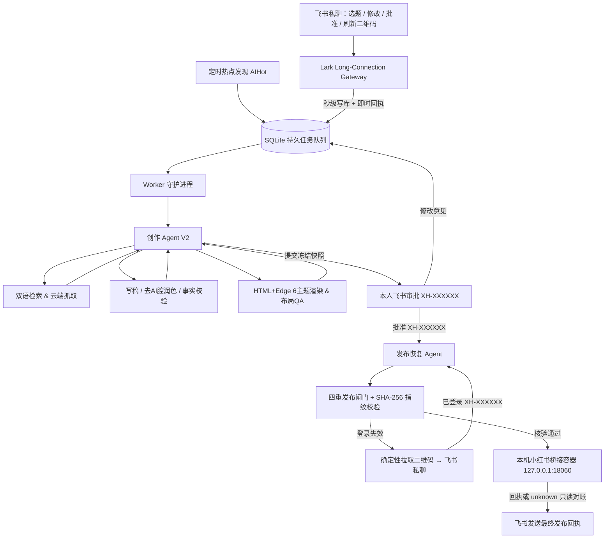

# XHS_Agent — 小红书双 Agent 运营助手

> 在飞书私聊里一句话提选题、审图文、提修改意见并批准发布；创作 Agent 自主检索取材、去 AI 腔写作、HTML/Edge 多主题渲染精美卡片；发布 Agent 严格守住审批指纹，负责提交发布、扫码登录闭环与未知结果只读对账。

[](https://www.python.org/)
[](#核心安全与工程边界)

---

## 核心亮点

- **双有界 Agent 架构（无重型第三方框架）**
  - **创作 Agent（Creator Agent V2）**：基于有界 ReAct 工具循环，自主完成中英双语检索、正文读取、初稿写作、按意见局部修订、排版渲染、布局自检与事实审稿。
  - **发布恢复 Agent（Publication Agent）**：只接收经本人明确批准的冻结快照（正文 + 图片字节 SHA-256），负责账号核验、同字节图片恢复、发帖提交与 `unknown` 状态的只读平台对账——**绝不盲目重发**。
- **高审美本地 HTML/CSS + 无头 Edge 渲染引擎**
  - 基于 Playwright 驱动本机 Microsoft Edge（无需额外下载浏览器、无需外部生图 API），支持 **6 套视觉主题**（`editorial` / `swiss` / `terminal` / `newsprint` / `notebook` / `poster`）× 多套调色板 × **12 种卡片版式** × 5 种封面变体。
  - 内置主题冷却轮换、封面 dHash 视觉相似度去重、空白带检测、CJK 标点规整与防拆行规则；支持一键回退至纯 Python Pillow 渲染。
- **人设驱动 + 确定性去 AI 腔护栏**
  - 通过可编辑的 [`config/voice.toml`](config/voice.toml) 定义账号人设、语气、开头/收尾招式与违禁套话词库，按选题类型（工具更新 vs. 行业热点）自适应切入角度。
  - 写稿后执行确定性 AI 味体检（12 条规则 + 跨篇开头/标题骨架去重），超阈值自动触发至多 1 轮受控润色，并强制重跑事实与数字校验——**若润色引入未证实数字立即回滚原稿**。
- **飞书私聊全闭环交互（无需公网 IP）**
  - 采用飞书官方 `lark-oapi` WebSocket 长连接，本机即可接收指令并秒级回执。
  - **小红书登录态闭环**：发布前自动核验登录态与账号 `redId`；若登录失效，确定性代码自动从本机桥接器拉取最新二维码 PNG 直接发到飞书私聊（二维码与凭据绝不进入大模型上下文，发送后自动清理临时文件），支持随时发 `刷新二维码` 获取新码，扫码后发 `已登录 XH-XXXXXX` 自动续发。

---

## 系统架构与数据流



本地共运行三个轻量进程（加一个可选的本机 Docker 小红书桥接容器）：

| 服务 | 职责 | 说明 |
| :--- | :--- | :--- |
| `gateway` | 飞书长连接入站与即时回执 | 仅接受绑定的 `owner_open_id` 私聊消息，消息 ID 幂等去重 |
| `worker` | 后台任务执行与通知投递 | 2 秒轻量轮询，驱动 Creator Agent、Publication Agent 与飞书推送 |
| `console` | 本机只读/审批控制台 | 默认仅监听 `127.0.0.1:8765`，拒绝非回环地址暴露 |
| `bot-xhs-bridge` | 小红书社区桥接（Docker） | 可选，仅映射 `127.0.0.1:18060`，只读挂载 `var/drafts` |

---

## 快速开始

### 环境要求

- **操作系统**：Windows 10/11（PowerShell 5.1+）
- **Python**：3.12
- **浏览器**：本机已安装 Microsoft Edge（供 Playwright 无头渲染；无 Edge 时可配置 `render.engine = "pillow"`）
- **依赖**：仅 3 个核心运行时依赖（见 [`requirements.txt`](requirements.txt)）：`Pillow`、`lark-oapi`、`playwright`

### 1. 安装依赖与离线 Demo 体验

无需任何外部账号、无需 API Key，即可在本地跑通“模拟采集 → 写稿 → 渲染 → 本地审批 → 模拟导出”全流程：

```powershell
# 1. 创建隔离虚拟环境并安装固定版本依赖（无需执行 playwright install）
.\setup-bot.cmd

# 2. （可选）下载免费商用中文字体到 assets/fonts/
powershell -ExecutionPolicy Bypass -File scripts\fetch_fonts.ps1

# 3. 运行离线 Demo（输出位于 var/demo，不联网、不发帖）
.\.venv\Scripts\python.exe -m bot demo
```

查看 6 套 HTML/Edge 视觉主题的离线渲染画廊与 QA 指标（空白带比例、封面 dHash 距离、单卡耗时）：

```powershell
.\.venv\Scripts\python.exe -B scripts\render_gallery.py --strict
# 输出拼图：var/gallery/contact.png
```

### 2. 配置真实运行环境（DeepSeek + 飞书 + 小红书桥接）

1. **复制配置模板**：将 [`config/bot.example.toml`](config/bot.example.toml) 复制为 `config/bot.live.toml`（该文件已被 `.gitignore` 忽略，不会被提交），按注释填写账号与渲染参数。
2. **配置密钥（绝不写入普通配置）**：在环境变量或未跟踪的 `config/secrets.toml` 中填入：
   ```toml
   deepseek_api_key = "your-deepseek-api-key"
   lark_app_id = "your-feishu-app-id"
   lark_app_secret = "your-feishu-app-secret"
   lark_owner_open_id = "your-personal-open-id"
   xiaohongshu_token = "your-local-bridge-token"
   ```
   详细配置指引参见 [飞书配置指南](docs/FEISHU_SETUP.md)、[小红书桥接配置](docs/XHS_BRIDGE_SETUP.md) 与 [容器图片路径映射](docs/CONTAINER_IMAGE_PATHS.md)。
3. **启动服务**：
   ```powershell
   # 仅测试选题、写稿、渲染与飞书审批（安全试运行，关闭真实发帖）
   powershell -NoProfile -ExecutionPolicy Bypass -File scripts\start.ps1 -Config "config/bot.live.toml"

   # 开启真实发布能力（仍需每篇在飞书私聊明确回复“批准 XH-XXXXXX”）
   $env:BOT_ALLOW_REAL_PUBLISH = "1"
   powershell -NoProfile -ExecutionPolicy Bypass -File scripts\start.ps1 -Config "config/bot.live.toml" -AllowRealPublishDaemon

   # 停止服务（严格核对进程身份，不误杀其他 Python 进程）
   powershell -NoProfile -ExecutionPolicy Bypass -File scripts\stop.ps1
   ```
   > 支持 `-GatewayOnly`、`-WorkerOnly`、`-ConsoleOnly` 按需启停；本地审批页默认位于 `http://127.0.0.1:8765`。

---

## 飞书私聊命令速查

所有命令仅接受绑定的 `owner_open_id` 私聊，群聊和非本人消息一律忽略。随时发送 **`帮助` / `菜单` / `help` / `/help`** 查看菜单。

| 分类 | 命令示例 | 说明 |
| :--- | :--- | :--- |
| **创作与改稿** | `选题 <主题或链接>` / `写一篇 <要求>` | 触发 Creator Agent V2 自主检索、写稿、渲染并送审 |
| | `修改 <意见>` 或 `修改 XH-XXXXXX <意见>` | 基于父版本与父材料定向修订；支持“保留第 N 张图” |
| **人工审批** | `批准 XH-XXXXXX` | 同意发布该精确快照（须已完整送达正文与全部图片） |
| | `拒绝 XH-XXXXXX` | 拒绝该审批，不会发布 |
| **登录与扫码** | `刷新二维码` / `获取二维码` | 拉取最新小红书登录二维码图片发至飞书私聊 |
| | `已登录 XH-XXXXXX` | 扫码完成后唤醒等待登录的发布任务并重新核验账号 |
| **发布与排障** | `发布状态 XH-XXXXXX` | 只读查询当前发布进度、尝试记录与平台笔记 ID |
| | `检查原因 XH-XXXXXX` | 触发只读诊断，不发起新发布 |
| | `修复并重试 XH-XXXXXX` | 恢复资产或重试；结果未知时先查原发送，不直接重发 |
| | `暂停发布` / `继续发布` / `取消发布 XH-XXXXXX` | 控制发布任务生命周期 |
| | `确认未发布并重试 XH-XXXXXX` | 仅在本人核实平台确实未发帖后授权新一次提交 |

---

## 核心安全与工程边界

本项目将“大模型自主性”严格限制在确定性程序护栏之内：

1. **四重发布闸门 + 精确快照指纹**
   - 真实发布必须同时满足：`app.mode = "live"` + `publisher.provider = "xiaohongshu"` + `publisher.live_enabled = true` + 环境变量 `BOT_ALLOW_REAL_PUBLISH=1` + 非演示管线 + owner 明确批准。
   - 审批单指纹（`approvals.fingerprint`）绑定平台、账号、草稿版本、正文 SHA-256、全部图片字节 SHA-256、计划时间与过期时间。审批后任何文字或图片变动都会使旧审批自动失效。
2. **未知结果只对账、绝不盲目重发**
   - 每次提交前采集账号已发布 feed 基线；若发帖请求超时或无明确回执，状态标记为 `unknown`，系统仅通过同账号（`expected_red_id`）基线外唯一新增笔记做只读对账，绝不自动重复 POST。
3. **事实与证据硬校验**
   - 正文与所有图片卡片（含 `stat` 数字、`quote` 原话、`timeline` 日期）中的数值均须在引用的原始材料全文中核实；模型润色若引入未证实数字会被自动丢弃并回滚原稿。
4. **网络与凭据隔离**
   - 外部网页采集受 `SSRFGuard` 保护，禁止访问私网/本机地址；HTML 渲染页面拦截一切非 `file://` / `data:` 外网请求；所有密钥与二维码图片绝不进入日志或 LLM 上下文。

---

## 项目目录结构

```text
bot/
  cli.py                       命令行入口（worker / gateway / console / doctor / demo）
  worker.py / jobs.py          后台循环、2秒轻量轮询与 SQLite 租约队列
  lark_gateway.py              飞书长连接事件接收与即时回执
  console.py                   本机回环审批控制台（127.0.0.1）
  content.py / typography.py   图文数据契约、数字证据校验与中文标点规整
  voice.py / style_lint.py     人设配置加载与 12 条确定性去 AI 腔规则
  render.py                    渲染分派与 Pillow 回退引擎
  visual/                      HTML/CSS + 无头 Edge 渲染引擎、6 套主题、12 种版式与去重
  adapters/                    DeepSeek LLM、检索/抓取、飞书通知与小红书桥接适配器
  services/
    creator_agent/             创作 Agent V2（决策、工具、版本、检查点、每日发现）
    publication_agent/         发布恢复 Agent（冻结包校验、诊断、同字节恢复、只读对账）
    approvals.py / publish.py  审批生命周期、飞书命令路由与发布闸门
    notifications.py           持久通知队列（文本 + 图片 + 临时二维码阅后即焚）
  schema.py / db.py            SQLite Schema 与事务封装
  security.py / budget.py      哈希指纹、SSRF 防护与每日 USD 预算守卫
config/
  bot.example.toml             无密钥运行配置模板
  voice.toml                   可编辑的账号人设、招式与违禁词配置
  editorial-profile.toml       长期编辑偏好配置
  xhs-compose.yml              本机小红书桥接 Docker Compose 模板
scripts/                       安装、启停、体检、字体下载与视觉画廊脚本
tests/                         完整单元测试与端到端离线回归套件
docs/                          架构走读、使用指南与交付文档
```

---

## 测试与开发

```powershell
# 运行全量离线单元测试与集成回归
$env:PYTHONIOENCODING = "utf-8"
.\.venv\Scripts\python.exe -B -m unittest discover -s tests -v
```

深入文档导航：
- [项目架构走读](docs/PROJECT_ARCHITECTURE_WALKTHROUGH.md)
- [Creator Agent V2 架构](docs/CREATOR_AGENT_V2_ARCHITECTURE.md) 与 [使用说明](docs/CREATOR_AGENT_V2_USAGE.md)
- [Publication Agent 架构](docs/PUBLICATION_AGENT_ARCHITECTURE.md) 与 [使用说明](docs/PUBLICATION_AGENT_USAGE.md)
- [飞书机器人配置](docs/FEISHU_SETUP.md) / [小红书桥接配置](docs/XHS_BRIDGE_SETUP.md)

---

## 免责声明

- 本项目为个人效率与大模型应用工程实践，**不内置任何平台破解或绕过风控逻辑**，所有内容发布均须经人工审阅与明确授权。
- 请遵守相关内容平台、信息来源及大模型服务商的使用条款，对自行发布的内容承担全部责任。
